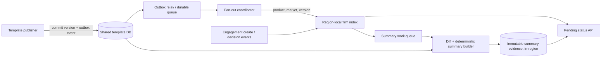

# Engagement template update awareness

## Decision

Keep engagement state in the firm’s region and build a small, event-maintained **template reference index** there. A template publication creates a durable fan-out job; it does not load engagements. The index supports the product/market/branch/version lookup needed to decide which files may have an update. The UI reads this index for its pending count and status. A separate, region-local worker prepares human-readable evidence on demand or asynchronously after the status changes.

The fast status path compares each indexed engagement’s applied version, branch, and decline watermark against the current published-version graph. It does not wait for the per-engagement downstream call. The publish outbox updates the regional version heads and enqueues fan-out work; status is derived immediately from those heads and the firm-local index. Summary preparation and any legacy repair remain asynchronous. A small publication/region counter projection can keep the at-a-glance count cheap, with reconciliation as its correctness backstop.

The request for end-to-end, per-engagement results “within seconds” conflicts with the hard one-minute engagement-load call and the downstream team’s limited capacity. I would challenge that requirement: publish visibility and pending status should update within seconds from the index; detailed summaries become available asynchronously under a stated SLO. The index removes the one-minute load from the critical path and from normal fan-out. If the index is unhealthy, show “status refreshing” rather than claim no update.

## Architecture and ownership

The shared template database owns immutable template versions, publication status, market/branch metadata, and the authoritative version graph. A publish event is written through a transactional outbox in the same commit as publication. The relay is at-least-once; consumers deduplicate by event ID and version. If the source database cannot support an outbox, use its change stream plus reconciliation against published-version records; never treat a best-effort webhook as the only record.

On AWS, the outbox relay can fan out through SNS to region-specific SQS queues. Use PostgreSQL (RDS for PostgreSQL initially) for each regional firm-local reference/index projection, decision watermark, and publish checkpoint; keep versioned S3 objects for immutable summary evidence. PostgreSQL fits the ordered product/market/version lookups, graph metadata, uniqueness constraints for event/idempotency keys, and transactional checkpoint updates. The queue payload carries only template/version identifiers and routing metadata. Keep queue, database, evidence, and worker in the firm’s required region; deployment account boundaries and IAM restrict cross-region access. Consider Aurora PostgreSQL only if measured availability or throughput needs justify its added cost and operational choices.

Each firm’s regional engagement system owns engagement IDs, template references, market, applied version, user decisions, and the compact index projection. Create, accepted-apply, decline, and relevant engagement mutations emit durable events. The projection is derived and rebuildable; it does not become a second authority for engagement content. No engagement workpaper or client data crosses regions. Global coordination carries only non-client template/version identifiers and aggregate health. EU and Canadian queues, workers, indexes, and evidence stores remain in-region.

## Version and decision semantics

Model versions as a directed graph per product and market, not as an integer sequence. A published target is eligible only when it is a non-withdrawn descendant of the engagement’s applied version on the applicable branch. A withdrawal removes that target from offers and invalidates any not-yet-shown summary; it does not rewrite past decisions or evidence. Ambiguous ancestry or incompatible branches are surfaced for content-owner resolution, not guessed.

Keep `appliedVersion` separate from a decision watermark. Accept is recorded by the existing apply workflow and advances `appliedVersion` only after that workflow succeeds. Decline records and suppresses the exact target version dismissed; it does not imply the content was applied. Any later eligible descendant or other eligible target is still considered, so a file that declined v5 can later be offered v7, with a cumulative summary that may include v5’s changes. On each refresh, select the latest non-withdrawn eligible target under the market’s branch policy and summarize the cumulative diff from the engagement’s current applied version. When no such target exists, there is no pending offer. Several publications before a decision coalesce to the latest eligible target while retaining the individual versions and diffs in the evidence chain.

Updates to the index and decision state use monotonic event sequence numbers / optimistic versions, idempotency keys, and compare-and-set so delayed events cannot roll state backwards. The existing engagement decision path remains authoritative; its event is retried until the projection converges.

## Human-readable, reviewable summaries

Use the supplied structural JSON diff and deterministic domain rules first: group changes under familiar template sections, translate known field identifiers into content-team labels, and describe additions/removals/changes with before/after values where safe. Omit or redact any engagement-derived values; the summary describes template content only. Unknown fields are shown under a neutral “Other template changes” group with a stable path, not silently discarded.

An LLM is optional, off the decision path, and only used to rewrite already-computed facts into plain language. It cannot decide eligibility, infer impact, or create facts. Require every generated statement to map to a diff record; check that every material diff operation is represented or has a recorded redaction/omission reason, and fall back to the deterministic summary on unsupported claims, validation failure, or budget exhaustion. Evaluate clarity and factual fidelity against a reviewed set of representative diffs with content specialists; monitor corrections and fallback rate. Send template diffs only, never engagement-derived content, to an approved model endpoint. Persist immutable evidence in-region: source and target version IDs, graph/market resolution, diff hash and schema, rendered summary, generator/rules version, model and prompt version if used, validation result, and timestamps. UI views reference that snapshot, so a March explanation can be reconstructed in November even if the model, prompt, labels, or template later change. Retain/restrict access according to firm retention policy; audit reads and decisions.

## Scale, cost, and operations

Given: 800,000 active files, 40 products, 4,000 firms; average 200 files/firm (median about 40; largest about 40,000). At one publish/product/week, the average product has about 20,000 indexed references. Across all products this is 800,000 reference evaluations/week, or **1.32/sec average** (800,000 / 604,800). If every reference requires the one-minute downstream call, steady-state demand is **800,000 minutes/week = 13,333 call-hours/week**, requiring about **79.4 concurrent calls** continuously just to keep up on average (13,333 / 168), before retries and bursts. A single 40,000-file firm requires pagination and fair scheduling; it must not monopolize a regional worker. One 40,000-file product publish takes **667 hours** sequential; at 80 slots it still takes about **500 minutes (8.3 hours)**. Finishing that batch in five minutes would require 8,000 simultaneous one-minute calls, which is not a credible default for a limited-capacity dependency. This is why pending status must not depend on finishing the slow fan-out; use the index/head path and keep detail work asynchronous.

Backfill is an exception. At concurrency C, the theoretical lower bound for 800,000 existing files is `800,000 / C` minutes (e.g. C=100: 5.6 days; C=500: 26.7 hours), before retries and throttling. Do not assume those capacities are available: negotiate a global downstream permit budget, begin with a low rate, observe saturation, and pause automatically when latency/error budgets are exceeded. Backfill per region/firm with resumable cursors, small pages, and fairness; publish derived state as “unknown” until each record is inventoried. Lifecycle hooks keep new/changed records current during the scan. No maintenance window is required.

The brief gives a literal `$X/month` rather than a numeric budget, so a credible dollar total cannot be calculated. Make the cap a launch gate. Track monthly cost as `regional index storage + queue/compute + summary storage + diff/LLM calls + observability`; publish a per-file and per-summary unit cost and enforce a monthly inference budget. Diffs are shared/cached by `(product, source version, target version, rules version)`; summaries are generated only for visible pending offers, not for every file on every publish. Prefer deterministic generation; if using a model, batch where practical, set a strict token/call budget, and fall back without blocking status. Product must supply `$X` and acceptable summary freshness before a cost SLO can be signed.

## Correctness, rollout, and SLOs

Deploy the event consumers and projection in shadow mode first. Reconcile event-derived state against authoritative records; then backfill existing files with rate limits and resumable cursors. Compare counts and sampled version references before enabling UI reads by cohort/region. Keep the old experience available behind a feature flag. Reconciliation jobs detect missed events, stale cursors, unknown graph edges, and projection drift; repair is replayable and idempotent.

Suggested initial SLOs (final values set with product): publication committed to pending status visible: **99% within 10 seconds**, 99.9% within 1 minute. Do not promise a publish-wide detailed-summary freshness SLO until the downstream team commits to a capacity budget: with one-minute calls, completion time is approximately `eligible references / available concurrent slots` minutes. Measure and publish queue wait separately from per-item processing time; cache identical version-pair summaries and prioritize user-requested detail. Monitor outbox age, queue lag, fan-out progress, event dedupes, projection drift, unknown/withdrawn targets, summary fallback rate, generation latency, and per-region data location. Alert on sustained SLO burn and downstream permit utilization. Use bounded queues, exponential backoff with jitter, retry limits plus dead-letter queues, and operator replay. A failed summary never hides pending status. A failed regional service leaves the last known status clearly timestamped; after recovery, replay and reconcile before claiming freshness.

**Riskiest assumption:** lifecycle events expose a stable engagement ID and the template reference/decision needed to maintain a complete index, including legacy records. If not, the only reliable bootstrap requires the constrained one-minute load path, so downstream capacity and rollout time become the critical feasibility risk.

**Deliberately out of scope:** applying template contents, modifying engagement workpapers, redesigning the template authoring/version UI, and automatic interpretation of arbitrary unknown JSON fields. The existing apply workflow remains the owner of content changes.
