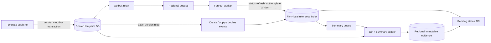

# Engagement template update awareness

## Decision and architecture

Keep engagement state in each firm's required region. Maintain a small, rebuildable reference
projection there so pending status does not require opening an engagement. Template versions are
shared, immutable, and addressable by `(template ID, version)` in the existing shared template
database. Publication writes the version and a transactional outbox event together. A regional
consumer updates published-version heads and enqueues bounded fan-out work. New engagement
creation resolves the current eligible version, reads that exact version from the shared catalog,
and records its ID/version with the engagement.

The template database owns the version graph, market/branch metadata, publication and withdrawal
state, and template bytes. Each firm's regional engagement system remains authoritative for
engagement IDs, applied versions, and user decisions. Its lifecycle events maintain the
projection; template publication never scans or loads engagement files synchronously. Events
carry only template/version and routing identifiers, not client workpaper content.

The included Java component implements only the bounded publish worker. The existing template
database, outbox relay, queue, regional index, summary pipeline, and engagement writer are outside
this implementation. The worker's downstream call only makes the engagement aware of a target or
enqueues a local refresh; it must not apply template content.

## Example AWS mapping

The design is intentionally cloud-agnostic; this is one possible fit for an AWS environment, not a
requirement to change the architecture. Keep the existing shared template catalog on its current
database (or Amazon RDS/Aurora if a managed AWS database is needed). An outbox relay can publish to
regional Amazon SQS queues; run the bounded Java worker on ECS with Fargate, and store the regional
reference projection in DynamoDB. Store immutable regional evidence in S3, and use CloudWatch for
metrics, logs, and alarms. Preserve the same durability, idempotency, regional-residency, and
capacity controls regardless of the AWS service selected.

## Correctness, decisions, and evolution

Versions form a directed graph, not a numeric sequence. For each market/branch, offer only a
non-withdrawn published descendant of the engagement's applied version. A withdrawn version is
removed from current offers and invalidates unshown summaries through a separate idempotent
withdrawal event; retain historical decisions and evidence. If ancestry or branch compatibility is
ambiguous, mark the status unresolved for content owner review rather than guessing.

Accept advances `appliedVersion` only after the existing apply workflow succeeds. Decline suppresses
the exact offered target, not all future descendants: declining v5 can still allow v7, whose
cumulative summary may include v5's changes. Multiple publications before a decision coalesce to
the latest eligible target while retaining the path and diffs needed for explanation. Sequence
numbers/optimistic versions, compare-and-set, and idempotency keys prevent delayed events from
rolling projection state backward.

The relay and queues are at-least-once. Consumers deduplicate by event ID/version; every projection
mutation and downstream refresh is idempotent. The worker uses stable per-event/per-engagement
keys, bounded in-flight concurrency, a globally coordinated capacity lease, capped exponential
backoff with jitter, and a durable cursor. It advances a page cursor only after every item succeeds
or is durably dead-lettered. Capacity exhaustion defers the event without dead-lettering it or
advancing the cursor. A crash replays the page safely. Dead-letter/checkpoint failures stop progress
so work is not acknowledged without durable completion.

Deploy hooks and projections in shadow mode. Reconcile them against authoritative engagement
records, then backfill existing files with resumable cursors, small pages, firm fairness, and a
negotiated downstream rate. Mark unscanned status unknown; lifecycle events keep new changes
current during the scan. Compare counts and sampled references by region before enabling UI reads
behind a cohort/region flag. Replay and reconciliation repair missed events and projection drift;
no maintenance window is required.

## Summaries, scale, and cost

Use the available structural JSON diff and deterministic rules first: group by familiar template
sections, label known fields, and describe additions/removals/changes with safe before/after values.
Show unknown fields under a stable neutral path; redact engagement-derived values. An LLM is
optional and only rewrites precomputed facts. Each statement must map to a diff record, and every
material operation must be represented or have an omission reason. Reject unsupported claims and
fall back to deterministic output. Evaluate clarity and fidelity with content specialists.

Persist immutable, regional evidence: source/target versions, resolved graph path, diff hash/schema,
rendered summary, rule/generator version, model/prompt version if used, validation result, and
timestamps. A March summary must be reproducible in a November review even after content, labels, or
models change. Send template diffs only to an approved model endpoint; never send engagement data.

At 800,000 active files and one weekly publication for each of 40 products, the average product has
20,000 references. That is 800,000 evaluations/week, or `800,000 / 604,800 = 1.32` per second
average. If every evaluation invokes the one-minute downstream call, demand is 13,333 call-hours
per week, or `13,333 / 168 = 79.4` concurrent calls continuously before retries and bursts. A
40,000-reference batch takes 667 hours serially, or about 500 minutes at 80 slots. Therefore pending
status must derive from the fast index/head path, not wait for fan-out. The 80-slot figure is an
illustration, not an assumed quota; negotiate global capacity and throttle based on observed
latency/errors.

The brief leaves the budget as `$X/month`, so a credible dollar estimate is impossible. Treat the
cap as a launch gate; report per-file and per-summary cost and cap inference spend. Cache diffs by
product/source/target/rules version and generate summaries only for visible pending offers. Product
must set the budget and summary-freshness target before cost SLOs are signed.

## Operations, tradeoffs, and risk

Target publication-to-pending visibility at 99% within 10 seconds and 99.9% within one minute,
subject to product agreement. Measure outbox age, queue lag, projection freshness/drift, fan-out
cursor progress, retries, dedupes, dead letters, downstream permit utilization/latency, summary
fallbacks, and regional data location. Alert on SLO burn and downstream saturation. A failed
summary never hides pending status; stale regional status must be timestamped and marked refreshing.

The hard one-minute engagement load conflicts with a seconds-level publish-wide completion
requirement. Challenge detailed-summary freshness, not pending-status freshness: compute status
from the index quickly and make summaries asynchronous. The riskiest assumption is complete,
reliable lifecycle events for legacy and new engagements; validate it during shadowing and
reconciliation. Applying template content, changing workpapers, UI redesign, and interpreting
unknown fields are deliberately out of scope. The product owner must define `$X`, and the downstream
owner must commit a quota before launch.
